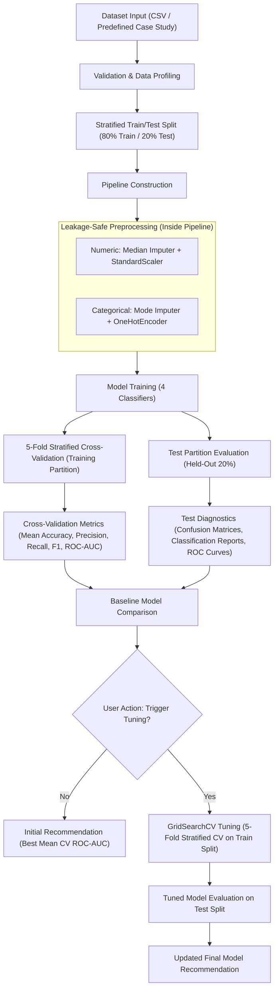

# Model Evaluation and Comparison System

A generalized machine-learning framework for evaluating, comparing, and selecting classification models across structured datasets.

---

## Project Overview

In applied machine learning, no single algorithm uniformly outperforms all others across different problem formulations, feature dimensions, or class distributions (the "no free lunch" theorem). The **Model Evaluation and Comparison System** addresses this challenge by providing a rigorous, leakage-safe comparative framework.

The framework benchmarks four foundational classifiers under standardized preprocessing and cross-validation pipelines:
- **Logistic Regression** (linear parametric baseline)
- **k-Nearest Neighbors (kNN)** (non-parametric instance-based learner)
- **Support Vector Machine (SVM)** (maximum-margin kernel classifier)
- **Random Forest** (ensemble decision tree learner)

### Core Framing and Scope
- **Custom Dataset Evaluation** serves as the generalized core engine of this platform. It allows users to upload arbitrary classification datasets in CSV format, perform automated validation and profiling, execute isolated 5-fold cross-validation, trigger hyperparameter tuning, and obtain data-driven model recommendations.
- **Wisconsin Diagnostic Breast Cancer** and **UCI Credit Card Default** are included as two rigorous real-world case studies demonstrating how the framework handles contrasting problem domains: high-signal medical diagnosis versus severe financial class imbalance.

---

## Key Features

- **Generalized Custom Dataset Evaluation**: Upload any classification CSV file and dynamically map any column as the target.
- **Automated Profiling and Validation**: Identifies column data types (numeric, categorical, unsupported), reports missing value distributions, and verifies stratified splitting feasibility.
- **Leakage-Safe Preprocessing**: Pipeline-encapsulated transformations ensure imputation and feature scaling are fit solely on training folds during cross-validation.
  - Numeric features: Median imputation followed by standard z-score scaling (`StandardScaler`).
  - Categorical features: Most-frequent value imputation followed by One-Hot Encoding (`OneHotEncoder`).
- **Standardized Benchmark Classifiers**: Parallel evaluation of Logistic Regression, kNN, SVM, and Random Forest.
- **Stratified 5-Fold Cross-Validation**: Preserves target class ratios across all validation folds to prevent sampling bias.
- **Multi-Metric Diagnostics**: Computes Accuracy, Precision, Recall, F1-score, and ROC-AUC.
  - Binary classification: User-designated positive class with exact positive-class recall/precision metrics.
  - Multiclass classification: Macro-averaged precision, recall, and F1-score, with one-vs-rest (OvR) macro ROC-AUC.
- **Visual Diagnostic Artifacts**: High-resolution confusion matrices, multi-model ROC curves, correlation heatmaps, and performance comparison bar charts.
- **User-Triggered Hyperparameter Tuning**: On-demand `GridSearchCV` optimization across defined parameter spaces without automated overhead on page initialization.
- **Evidence-Based Model Recommendation**: Automatically highlights the top-performing architecture based on Mean Cross-Validation ROC-AUC rather than misleading uncalibrated accuracy.
- **Interactive Multi-Page Streamlit Application**: Seamless UI with centralized routing between project overview, custom evaluation, and pre-computed case study dashboards.

---

## System Architecture

The following diagram illustrates the lifecycle of a dataset through the evaluation pipeline:



---

## Technology Stack

The system is implemented entirely in Python using modern, stable libraries:

| Layer | Technologies |
|---|---|
| **Language** | Python 3.10 / 3.11 |
| **Interactive UI** | Streamlit (`>= 1.0.0`) |
| **Machine Learning** | Scikit-Learn (`>= 1.0.0`) (`Pipeline`, `ColumnTransformer`, `StandardScaler`, `OneHotEncoder`, `SimpleImputer`, `StratifiedKFold`, `GridSearchCV`, `cross_validate`) |
| **Data Manipulation** | Pandas (`>= 1.3.0`), NumPy (`>= 1.21.0`) |
| **Visualization** | Matplotlib (`>= 3.4.0`), Seaborn (`>= 0.11.0`) |
| **Model Serialization** | Joblib (`>= 1.0.0`) |
| **Data Export** | Openpyxl (`>= 3.0.0`) |
| **Testing** | Pytest (`>= 7.0.0`) |

---

## Project Structure

```
sem_vproj_ml_2/
├── custom_dataset/
│   ├── __init__.py
│   ├── app.py                         # Streamlit page for custom dataset evaluation
│   └── evaluation.py                  # Isolated validation, preprocessing, and CV engine
├── datasets/
│   ├── breast_cancer_dataset.csv      # Wisconsin Diagnostic Breast Cancer dataset (569 rows)
│   ├── breast_cancer_before_preprocessing.xlsx
│   ├── breast_cancer_after_preprocessing.xlsx
│   ├── breast_cancer_test_results.csv # Baseline test evaluation metrics
│   ├── breast_cancer_cv_results.csv   # Baseline 5-fold cross-validation metrics
│   ├── breast_cancer_tuning_results.csv # GridSearchCV results for breast cancer models
│   ├── UCI_Credit_Card.csv            # Original credit card dataset (30,000 rows)
│   ├── credit_card_10k_subset.csv     # Stratified 10,000-row working subset
│   ├── credit_card_dataset.csv        # Cleaned credit card dataset (9,993 rows)
│   ├── credit_card_before_preprocessing.csv / .xlsx
│   ├── credit_card_after_preprocessing.csv / .xlsx
│   ├── credit_card_test_results.csv   # Baseline test evaluation metrics
│   ├── credit_card_cv_results.csv     # Baseline 5-fold cross-validation metrics
│   └── credit_card_tuning_results.csv # GridSearchCV results for credit card models
├── plots/
│   ├── breast_cancer_*.png            # Diagnostic charts (ROC curves, confusion matrices, distributions)
│   └── credit_card_*.png              # Diagnostic charts (ROC curves, confusion matrices, distributions)
├── tests/
│   ├── test_custom_dataset.py         # Unit and integration tests for custom dataset engine
│   └── test_smoke.py                  # Smoke tests verifying artifacts, schemas, and pipelines
├── breast_cancer_analysis.py          # Standalone training and benchmarking script for breast cancer
├── breast_cancer_app.py               # Standalone Streamlit dashboard for breast cancer
├── breast_cancer_best_model.pkl       # Serialized tuned pipeline (Logistic Regression)
├── breast_cancer_metadata.json        # Production metadata, parameters, and metrics
├── credit_card_analysis.py            # Standalone training and benchmarking script for credit card
├── credit_card_app.py                 # Standalone Streamlit dashboard for credit card
├── credit_card_best_model.pkl         # Serialized tuned pipeline (Random Forest)
├── credit_card_metadata.json          # Production metadata, parameters, and metrics
├── home.py                            # Central Streamlit navigation entry point
├── README.md                          # Project documentation
└── requirements.txt                   # Dependency specifications
```

---

## Installation and Setup

### Prerequisites
- Python 3.10 or 3.11 installed.
- Git (optional, if cloning from remote repository).
- Windows PowerShell or Unix-compatible shell.

### Setup (Windows PowerShell)

1. Open PowerShell and navigate to the project directory:
   ```powershell
   cd path\to\sem_vproj_ml_2
   ```

2. Create a clean virtual environment:
   ```powershell
   python -m venv .venv
   ```

3. Activate the virtual environment:
   ```powershell
   .\.venv\Scripts\Activate.ps1
   ```
   *(If script execution is restricted, run `Set-ExecutionPolicy -Scope Process -ExecutionPolicy Bypass` first).*

4. Upgrade `pip` and install dependencies:
   ```powershell
   python -m pip install --upgrade pip
   pip install -r requirements.txt
   ```

### Setup (Linux / macOS Bash)

```bash
cd path/to/sem_vproj_ml_2
python3 -m venv .venv
source .venv/bin/activate
pip install --upgrade pip
pip install -r requirements.txt
```

---

## Running the Application

### 1. Launching the Streamlit Web Application

The primary user entry point is `home.py`, which provides a unified navigation portal linking the home page, the Custom Dataset Evaluation interface, and both case studies.

Run the following command from the project root:

```powershell
streamlit run home.py
```

The interface will be accessible in your web browser at `http://localhost:8501`.

*Note: The individual case studies can also be launched directly if desired:*
```powershell
streamlit run breast_cancer_app.py
streamlit run credit_card_app.py
```

### 2. Generating or Refreshing Case-Study Results

The repository includes pre-generated models, metadata, and metric files. If you modify preprocessing logic or wish to re-execute the entire benchmarking and hyperparameter optimization workflow from scratch:

**Regenerate Breast Cancer Case Study:**
```powershell
python breast_cancer_analysis.py
```
*Outputs: Updates `breast_cancer_best_model.pkl`, `breast_cancer_metadata.json`, files in `datasets/`, and plots in `plots/`.*

**Regenerate Credit Card Default Case Study:**
```powershell
python credit_card_analysis.py
```
*Outputs: Updates `credit_card_best_model.pkl`, `credit_card_metadata.json`, files in `datasets/`, and plots in `plots/`.*

### 3. Running the Test Suite

Execute the automated test suite to verify pipeline integrity, metadata schemas, and custom dataset logic:

```powershell
python -m pytest
```

---

## Custom Dataset Evaluation

The **Custom Dataset Evaluation** module is the central, generalized component of this platform. It allows users to assess arbitrary structured classification problems without modifying codebase logic or risking data leakage.

### Workflow Steps
1. **Upload Dataset**: Upload a CSV file through the Streamlit upload widget.
2. **Select Target Column**: Select the column representing the ground-truth label.
3. **Dataset Overview and Profiling**:
   - Inspect data schemas, sample records, and row/column counts.
   - Review the paginated class distribution table showing absolute counts and sample percentages.
   - Review data quality indicators, missing value rates per feature, and column type classifications.
4. **Binary Positive Class Designation**:
   - For binary datasets, select which class represents the positive event (e.g., "Default", "Malignant", "Purchased").
   - For multiclass datasets, the engine automatically configures macro-averaged scoring and one-vs-rest metrics.
5. **Execute Evaluation**: Click **Run Custom Dataset Evaluation**.
   - Validates data against safety rules.
   - Creates an 80/20 stratified split.
   - Evaluates all four models using stratified 5-fold cross-validation on the training set and tests on the holdout test set.
6. **Analyze Diagnostics**:
   - **Model Comparison**: View side-by-side metric tables and bar charts.
   - **Classification Reports**: Precision, recall, and F1-score broken down by individual classes.
   - **Confusion Matrices**: True versus predicted counts per class.
   - **ROC Curves**: Binary threshold curves or interactive one-vs-rest multiclass ROC curves.
   - **Cross-Validation**: Fold-averaged scores across all metrics.
7. **User-Triggered Hyperparameter Tuning**:
   - Click **Run Hyperparameter Tuning** in the tuning tab.
   - Evaluates a parameter grid for each classifier exclusively across the training partition.
8. **Final Model Recommendation**:
   - Displays the recommended classifier based on the highest Mean Cross-Validation ROC-AUC (updated after tuning).

### Validation and Data Safety Rules
The engine applies strict checks before fitting:
- The uploaded CSV cannot be empty.
- The target column must exist and cannot contain any missing values (`NaN`).
- The target must contain at least two unique classes.
- There must be at least one feature column aside from the target.
- Columns with unsupported types (e.g., raw datetime objects, complex numbers) must be resolved or converted prior to evaluation.
- Columns consisting entirely of missing values are rejected.
- **Stratification Minimums**: Every target class must contain at least 2 instances for the 80/20 train-test split, and at least 5 instances in the 80% training partition to allow 5-fold cross-validation (`CV_SPLITS = 5`).

### Preprocessing Specifications
All transformations occur inside scikit-learn `Pipeline` objects within each cross-validation split:
- **Numerical Features**: Missing values imputed using the feature **median**; scaled to zero mean and unit variance using `StandardScaler`.
- **Categorical Features**: Missing values imputed using the **most frequent** value; one-hot encoded using `OneHotEncoder(handle_unknown='ignore', sparse_output=False)`.

### Parameter Grids for Custom Tuning
When tuning is triggered by the user, `GridSearchCV` searches the following spaces:
- **Logistic Regression**: `C`: `[0.1, 1.0, 10.0]`
- **k-Nearest Neighbors**: `n_neighbors`: dynamically selected based on training fold size from `[3, 5, 7, 11]`; `weights`: `['uniform', 'distance']`
- **Support Vector Machine**: `C`: `[0.1, 1.0, 10.0]`; `kernel`: `['linear', 'rbf']`
- **Random Forest**: `n_estimators`: `[100, 200]`; `max_depth`: `[None, 10]`; `min_samples_split`: `[2, 5]`

---

## Case Studies

The system includes two fully benchmarked case studies demonstrating the evaluation methodology across different problem domains.

### 1. Wisconsin Diagnostic Breast Cancer

- **Dataset Overview**: 569 patient instances with 30 continuous real-valued features computed from digitized fine needle aspirate (FNA) images of breast masses.
- **Target Variable**: `target`
  - `0`: **Malignant** (212 instances, 37.26%) — Designated **Positive Class**
  - `1`: **Benign** (357 instances, 62.74%)
- **Clinical Evaluation Rationale**: In oncological diagnosis, a false negative (classifying a malignant case as benign) can delay life-saving treatment. Therefore, **Malignant Recall** and **ROC-AUC** are prioritized over overall accuracy.
- **Partitioning**: 80% stratified training partition (455 records) and 20% stratified test partition (114 records).

#### Verified Baseline Results (Held-Out Test Set)

| Model | Accuracy | Malignant Precision | Malignant Recall | Malignant F1 | Malignant ROC-AUC |
|---|---|---|---|---|---|
| **Logistic Regression** | **0.9825** | **0.9762** | **0.9762** | **0.9762** | **0.9954** |
| **kNN** | 0.9561 | 0.9512 | 0.9286 | 0.9398 | 0.9788 |
| **SVM** | **0.9825** | **0.9762** | **0.9762** | **0.9762** | 0.9950 |
| **Random Forest** | 0.9561 | 0.9512 | 0.9286 | 0.9398 | 0.9939 |

#### Verified Stratified 5-Fold Cross-Validation (Training Partition)

| Model | CV Accuracy | CV Precision | CV Recall | CV F1 | CV Malignant ROC-AUC |
|---|---|---|---|---|---|
| **Logistic Regression** | **0.9780** | **0.9770** | **0.9647** | **0.9703** | **0.9959** |
| **kNN** | 0.9626 | 0.9707 | 0.9294 | 0.9490 | 0.9882 |
| **SVM** | 0.9692 | 0.9649 | 0.9529 | 0.9583 | 0.9956 |
| **Random Forest** | 0.9626 | 0.9440 | 0.9588 | 0.9506 | 0.9896 |

#### Hyperparameter Optimization & Final Selection

- **Search Configuration**: 5-fold cross-validation optimizing Malignant ROC-AUC.
- **Tuned Parameters & Scores**:
  - Logistic Regression: `C=1, solver='liblinear'` — **Mean CV ROC-AUC: 0.9960**
  - kNN: `n_neighbors=9, p=2, weights='distance'` — Mean CV ROC-AUC: 0.9904
  - SVM: `C=0.1, gamma='scale', kernel='linear'` — Mean CV ROC-AUC: 0.9957
  - Random Forest: `max_depth=None, min_samples_split=2, n_estimators=100` — Mean CV ROC-AUC: 0.9896
- **Final Model Selected**: **Logistic Regression** (`C=1, solver='liblinear'`).
  - Achieved the highest Mean CV Malignant ROC-AUC (**0.9960**) and Test ROC-AUC (**0.9957**), delivering strong linear separation with zero false negatives on benign samples and high interpretability.

---

### 2. UCI Credit Card Default

- **Dataset Overview**: Financial and demographic customer data from Taiwan credit card clients. Features include credit limit, repayment status (`PAY_0` to `PAY_6`), monthly bill statements, and previous transaction payments.
- **Data Preprocessing & Cleaning**:
  - The raw dataset (`30,000` records) was reduced using reproducible stratified sampling (`train_size=10,000, random_state=42`) to create a working dataset.
  - The arbitrary identifier column `ID` was removed.
  - Duplicate records were dropped, leaving **9,993 verified instances**.
- **Target Variable**: `default.payment.next.month`
  - `0`: **No Default** (7,787 instances, ~77.92%)
  - `1`: **Default** (2,206 instances, ~22.08%) — Designated **Positive Class**
- **Class Imbalance Impact**: In this dataset, a naive model predicting "No Default" for all records achieves ~77.9% accuracy with zero predictive utility for default risk. Therefore, **ROC-AUC**, **Recall**, and **Precision** are essential evaluation metrics.
- **Partitioning**: 80% stratified training partition (7,994 records) and 20% stratified test partition (1,999 records).

#### Verified Baseline Results (Held-Out Test Set)

| Model | Test Accuracy | Test Precision | Test Recall | Test F1-Score | Test ROC-AUC |
|---|---|---|---|---|---|
| **Logistic Regression** | 0.8129 | **0.7297** | 0.2443 | 0.3661 | 0.7298 |
| **kNN** | 0.7909 | 0.5484 | 0.3077 | 0.3942 | 0.6911 |
| **SVM** | 0.8189 | 0.6961 | 0.3213 | 0.4396 | 0.7147 |
| **Random Forest** | **0.8229** | 0.6746 | **0.3846** | **0.4899** | **0.7363** |

#### Verified Stratified 5-Fold Cross-Validation (Training Partition)

| Model | CV Accuracy | CV Precision | CV Recall | CV F1 | CV ROC-AUC |
|---|---|---|---|---|---|
| **Logistic Regression** | 0.8080 | **0.6968** | 0.2353 | 0.3514 | 0.7162 |
| **kNN** | 0.7900 | 0.5444 | 0.3128 | 0.3966 | 0.6942 |
| **SVM** | 0.8160 | 0.6756 | 0.3230 | 0.4365 | 0.7238 |
| **Random Forest** | **0.8147** | 0.6458 | **0.3603** | **0.4618** | **0.7587** |

#### Hyperparameter Optimization & Final Selection

- **Search Configuration**: 5-fold cross-validation optimizing ROC-AUC across non-linear boundaries.
- **Tuned Parameters & Scores**:
  - Logistic Regression: `C=1, class_weight=None, solver='lbfgs'` — Mean CV ROC-AUC: 0.7162
  - kNN: `n_neighbors=7, weights='uniform'` — Mean CV ROC-AUC: 0.7073
  - SVM: `C=1, gamma='scale', kernel='rbf'` — Mean CV ROC-AUC: 0.7238
  - Random Forest: `class_weight=None, max_depth=10, min_samples_split=2, n_estimators=200` — **Mean CV ROC-AUC: 0.7741**
- **Final Model Selected**: **Random Forest** (`max_depth=10, min_samples_split=2, n_estimators=200`).
  - Achieved the highest Mean CV ROC-AUC (**0.7741**) and Test ROC-AUC (**0.7577**).
  - Test metrics of tuned model: Accuracy = 0.8209, Precision = 0.6858, Recall = 0.3507, F1 = 0.4641.
  - Significantly outperforms linear and distance-based classifiers in modeling complex non-linear feature interactions between past billing amounts and delayed payments.

---

## Evaluation Metrics

The system uses standard statistical classification metrics:

- **Accuracy**: Total fraction of correct predictions:
  $$\text{Accuracy} = \frac{TP + TN}{TP + TN + FP + FN}$$
  *Caveat: Highly misleading in imbalanced contexts (e.g., credit card default).*
- **Precision**: Proportion of positive predictions that were correct:
  $$\text{Precision} = \frac{TP}{TP + FP}$$
  Measures the cost of false alarms.
- **Recall (Sensitivity)**: Proportion of actual positive instances successfully detected:
  $$\text{Recall} = \frac{TP}{TP + FN}$$
  Critical in high-stakes domains (cancer detection, default detection).
- **F1-Score**: Harmonic mean of Precision and Recall:
  $$\text{F1} = 2 \times \frac{\text{Precision} \times \text{Recall}}{\text{Precision} + \text{Recall}}$$
  Balances precision and recall into a single metric.
- **ROC-AUC**: Area Under the Receiver Operating Characteristic curve. Evaluates the classifier's ability to rank positive instances higher than negative instances across all discrimination thresholds, independent of classification cutoffs.
- **Confusion Matrix**: Contingency matrix detailing true positive ($TP$), true negative ($TN$), false positive ($FP$), and false negative ($FN$) predictions.
- **Stratified K-Fold Cross-Validation**: Splits data into $K$ partitions while preserving the target class proportions, reducing variance and guarding against sample order bias.

---

## Results and Visualizations

Diagnostic charts generated during analysis are stored in `plots/` and embedded dynamically in the Streamlit application:

### Breast Cancer Case Study Visualizations
- **ROC Curves**: Comparison of all 4 classifiers with malignant as the positive class.
  Relative path: `plots/breast_cancer_roc_curves.png`
- **Confusion Matrices (Combined Grid)**: 2x2 grid showing prediction counts for all four models.
  Relative path: `plots/breast_cancer_confusion_matrices.png`
- **Model Comparison**: Bar chart comparing Accuracy, Precision, Recall, F1, and ROC-AUC.
  Relative path: `plots/breast_cancer_model_comparison.png`
- **Exploratory Data Analysis**:
  - Class distribution: `plots/breast_cancer_class_distribution.png`
  - Feature distributions: `plots/breast_cancer_feature_distributions.png`
  - Correlation heatmap: `plots/breast_cancer_correlation_heatmap.png`
  - Boxplots by class: `plots/breast_cancer_boxplots.png`

### Credit Card Default Case Study Visualizations
- **ROC Curves**: Ranking performance comparison across threshold values.
  Relative path: `plots/credit_card_roc_curves.png`
- **Confusion Matrices (Combined Grid)**: Evaluation of default detection counts.
  Relative path: `plots/credit_card_confusion_matrices.png`
- **Model Comparison**: Test set performance metrics across all models.
  Relative path: `plots/credit_card_model_comparison.png`
- **Exploratory Data Analysis**:
  - Class distribution: `plots/credit_card_class_distribution.png`
  - Feature distributions: `plots/credit_card_feature_distributions.png`
  - Correlation heatmap: `plots/credit_card_correlation_heatmap.png`
  - Boxplots by class: `plots/credit_card_boxplots.png`

---

## Model Tuning and Recommendation Methodology

### Hyperparameter Search
Tuning is conducted using `GridSearchCV` wrapped inside scikit-learn pipelines with 5-fold stratified cross-validation on the training set:
1. Preprocessing transformations are fit independently inside each CV fold to prevent information leakage.
2. The optimization metric matches the problem formulation: Malignant ROC-AUC for Breast Cancer, standard ROC-AUC for Credit Card Default, and positive-class / macro OvR ROC-AUC for custom datasets.

### Recommendation Logic
The system **does not** select models based solely on raw test accuracy.
- Selection is driven by **Mean Cross-Validation ROC-AUC**.
- In the **Custom Dataset** module:
  - An initial recommendation is made based on the baseline 5-fold CV ROC-AUC scores.
  - When the user triggers hyperparameter tuning, the recommendation dynamically updates to reflect the highest tuned Mean CV ROC-AUC score.
- This criterion ensures that the selected model demonstrates robust ranking ability across decision thresholds without overfitting the test split.

---

## Saved Artifacts and Outputs

The system persists models and evaluation artifacts to disk:

1. **Serialized Models (`.pkl`)**:
   - `breast_cancer_best_model.pkl`: Full trained pipeline (StandardScaler + Logistic Regression).
   - `credit_card_best_model.pkl`: Full trained pipeline (StandardScaler + Random Forest).
2. **Metadata Files (`.json`)**:
   - `breast_cancer_metadata.json` & `credit_card_metadata.json`: Feature schemas, best hyperparameters, test metrics, cross-validation metrics, and training timestamps.
3. **Tabular Results (`.csv` / `.xlsx`)**:
   - Baseline test metrics: `*_test_results.csv`
   - Cross-validation results: `*_cv_results.csv`
   - Hyperparameter tuning summaries: `*_tuning_results.csv`
   - Preprocessed dataset exports: `*_after_preprocessing.csv` and `.xlsx`
4. **Diagnostic Plots (`.png`)**:
   - High-resolution (150 DPI) plots stored in the `plots/` directory.

---

## Limitations

- **File Format**: The custom dataset evaluation module currently accepts files in CSV format only.
- **Classification Only**: The framework is designed for binary and multiclass classification tasks; regression tasks are outside the current scope.
- **Unsupported Feature Types**: Non-numeric and non-categorical data types (such as raw unstructured text, image matrices, or unparsed datetime strings) must be preprocessed prior to upload.
- **Sample Size Requirements**: For stratified 5-fold cross-validation, every class must have at least 5 instances in the training set (minimum 2 instances in the total dataset for the 80/20 split). Datasets with severe extreme sparsity (fewer than 5 instances of a minority class) cannot complete 5-fold validation.
- **Fixed Model Suite**: Evaluation is scoped to the four benchmark classifiers (Logistic Regression, kNN, SVM, and Random Forest).

---

## Future Enhancements

- **Gradient Boosting Algorithms**: Integration of XGBoost, LightGBM, and CatBoost into the standard comparison suite.
- **Explainable AI (XAI)**: Integration of SHAP (SHapley Additive exPlanations) and LIME summary plots to interpret model predictions.
- **Automated Report Generation**: One-click generation of downloadable PDF evaluation reports summarizing metrics, confusion matrices, and model parameters.
- **Cost-Sensitive Learning**: Configurable misclassification cost matrices for imbalanced domains where false negatives incur specific monetary penalties.
- **Expanded Input Support**: Support for Parquet, JSON, and Excel file formats in the custom upload workflow.

---

## Troubleshooting

### Missing Dependencies
- **Symptom**: `ModuleNotFoundError: No module named 'streamlit'` (or `sklearn`, `openpyxl`).
- **Solution**: Verify the virtual environment is activated (`.\.venv\Scripts\Activate.ps1`), then run:
  ```powershell
  pip install -r requirements.txt
  ```

### Module Import Errors During Pytest
- **Symptom**: `ModuleNotFoundError: No module named 'custom_dataset'` when running `pytest`.
- **Solution**: Execute pytest as a module from the project root so the current directory is appended to `sys.path`:
  ```powershell
  python -m pytest
  ```

### Missing Case Study Artifacts
- **Symptom**: Streamlit displays a warning that model or metadata files could not be found.
- **Solution**: Re-run the analysis scripts to generate all required `.pkl`, `.json`, and `.csv` files:
  ```powershell
  python breast_cancer_analysis.py
  python credit_card_analysis.py
  ```

### Custom Dataset Validation Errors
- **Symptom**: `DatasetValidationError: The target column contains missing values.`
- **Solution**: Ensure your target column has no null or empty entries before uploading. Missing feature values are supported and imputed automatically, but target labels must be complete.
- **Symptom**: `The 80% training partition does not have five examples for every class...`
- **Solution**: Ensure your dataset contains at least 5 examples of every class in the training split so that 5-fold stratified cross-validation can be performed.

### Streamlit Port Conflicts
- **Symptom**: `Port 8501 is already in use.`
- **Solution**: Specify an alternative port when launching:
  ```powershell
  streamlit run home.py --server.port 8502
  ```
